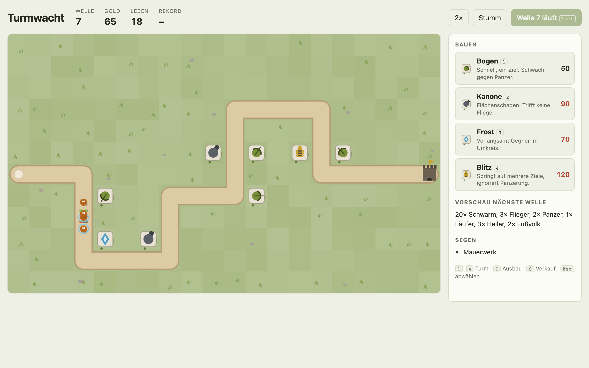

# Turmwacht

Tower Defense im Browser mit Roguelike-Anteil: Jede Partie hat eine neue, zufällig erzeugte Karte. Alle fünf Wellen wählst du einen von drei Segen, der Rest der Partie baut darauf auf. Die Wellen gehen endlos weiter, dein Rekord wird lokal gespeichert.



- **4 Türme** mit je 3 Ausbaustufen und Zielwahl (vorderster, stärkster, nächster): Bogen, Kanone (Fläche, keine Flieger), Frost (bremst), Blitz (Kettenschaden, ignoriert Panzerung)
- **8 Gegnertypen**: Läufer, Fußvolk, Schwarm, Flieger (Luftlinie statt Weg), Panzer (Panzerung), Heiler (heilt Nachbarn), Teiler (zerfällt in Schwarm), Koloss (Boss alle 10 Wellen)
- **9 Segen**, z. B. Zinsen, Kopfgeld, Überladung, Permafrost
- **Klänge** werden komplett per Web Audio API synthetisiert, keine Audiodateien
- Vorschau der nächsten Welle, 2×-Tempo, Tastatursteuerung, hell/dunkel nach Systemeinstellung

## Starten

Kein Build, keine Abhängigkeiten. Wegen der ES-Module nicht per `file://` öffnen:

```bash
python3 -m http.server 8000
```

Dann `http://localhost:8000` öffnen.

## Steuerung

Bestimmte Karte spielen oder teilen: `?seed=1234` an die Adresse hängen.

`1`–`4` Turm wählen · Klick aufs Feld baut (oder Spielfeld fokussieren, Pfeiltasten, `Enter`) · Klick auf Turm wählt ihn aus · `U` ausbauen · `S` verkaufen (70 %) · `Leertaste` nächste Welle · `F` Tempo · `M` Ton · `Esc` abwählen

## Tests

```bash
node --test
```

Prüft Pfaderzeugung (300 Seeds: zusammenhängend, ohne Berührung), Bauen/Ausbau/Verkauf, Panzerung, Frost, Teiler, Perk-Wahl, Wellenwachstum und eine lange Partie auf numerische Stabilität.

Balance wurde mit einem einfachen Bot gemessen (gierig bauen, ausbauen, ersten Segen nehmen): über 12 Karten erreicht er im Schnitt Welle 24 (11 bis 33). Die Streuung hängt nicht an der Weglänge (34–47 Felder), sondern an der stumpfen Bot-Strategie (feste Turmreihenfolge, auch Kanonen gegen frühe Flieger).

## Aufbau

- `game.mjs` – Spiellogik ohne DOM (Karte, Wellen, Türme, Gegner, Segen)
- `audio.mjs` – Klangsynthese
- `main.mjs` – Zeichnen auf Canvas, Eingabe, Oberfläche

## Lizenz

[MIT](LICENSE)
